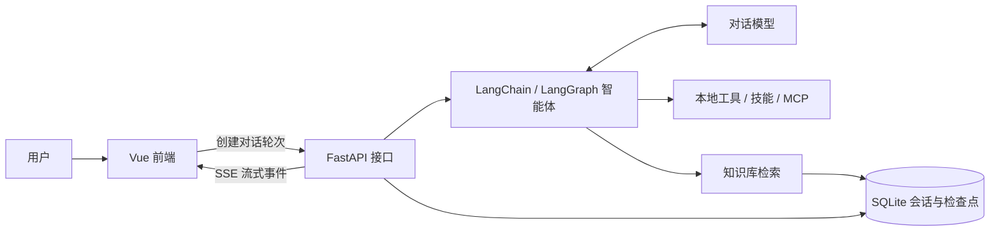

# Harness

Harness 是一个用于学习和实践 AI 智能体的全栈项目。它把流式对话、模型接入、工具调用、技能包、MCP 服务和知识库集中到一个 Web 应用中，便于观察一次提问如何经过前端、接口、智能体和工具，最终返回结果。

项目分为 Vue 前端、FastAPI 应用层与独立的 `harness` 智能体框架代码。当前仓库适合本地体验、阅读实现和扩展功能；部署脚本的适配状态见[部署说明](#部署说明)。

## 目录

- [主要功能](#主要功能)
- [技术栈](#技术栈)
- [运行流程](#运行流程)
- [快速开始](#快速开始)
- [使用指南](#使用指南)
- [配置指南](#配置指南)
- [项目结构](#项目结构)
- [接口概览](#接口概览)
- [开发与构建](#开发与构建)
- [部署说明](#部署说明)
- [常见问题](#常见问题)

## 主要功能

### 对话与会话

- 支持流式展示正文、推理过程、工具调用状态及令牌用量，并可停止正在进行的回复。
- 会话历史保存在本地，可继续已有会话、修改标题、删除会话或搜索历史消息。
- 对话可附带上传文件，也可为当前提问选择知识库。模型的推理与视觉选项由所选模型的配置决定。
- 生成图片由工具及对应图片服务配置驱动；生成后可在会话中预览或下载。

### 模型、工具与扩展

- 模型列表从 `backend/config.yaml` 读取；示例配置包含 DeepSeek 和通义千问模型，列表第一项是默认模型。
- 内置文件操作、文档处理、图片和网络等工具。工具在配置中登记，可按需检索后交给智能体调用。
- 项目技能位于 `backend/skills/custom/`，第三方技能可安装到 `backend/skills/public/`。
- 可配置 MCP 服务器，并从设置页面管理其启用状态、连接信息与工具刷新。
- 后端包含可配置的子代理机制；示例配置提供 `general-purpose` 子代理。

### 知识库

- 可创建多个知识库，上传文档并查看索引状态、切片内容和检索结果。
- 支持 `.md`、`.markdown`、`.txt`、`.html`、`.htm`、`.pdf` 和 `.docx` 文件。
- 上传后异步解析、分块和生成向量。索引失败的文档可在页面或接口中重试。
- 使用知识库前，需要配置 OpenAI 兼容的嵌入服务地址、密钥及与服务匹配的模型参数。

## 技术栈

| 层次 | 主要技术 | 职责 |
| --- | --- | --- |
| 前端 | Vue 3、TypeScript、Vite、Vue Router、Pinia、Element Plus | 页面、状态、配置界面与流式事件展示 |
| API | Python 3.12+、FastAPI、Uvicorn、Pydantic | 请求校验、业务接口与 SSE 响应 |
| 智能体 | LangChain、LangGraph、MCP | 模型装配、工具调用、中间件与子代理 |
| 存储与检索 | SQLite、sqlite-vec、MarkItDown | 会话持久化、检查点、文档解析与向量检索 |

## 运行流程



1. 前端将消息、会话 ID、模型选项、附件及可选知识库提交给 `/api/chat` 接口。
2. 后端创建对话轮次，构建智能体，并装配模型、工具、中间件及会话检查点。
3. 智能体按需调用工具或知识库；执行过程通过 SSE 逐帧返回前端。
4. 前端按事件类型更新正文、推理和工具调用视图；会话历史与检查点写入 SQLite。

前后端接口默认统一使用 `/api` 前缀，健康检查 `/health` 除外。

## 快速开始

### 环境要求

- Python 3.12 或更高版本，以及 [uv](https://docs.astral.sh/uv/)
- Node.js `^22.18.0` 或 `>=24.12.0`，以及 npm
- 至少一个计划使用的对话模型所需的 API Key
- 如需知识库索引和检索，还需可用的嵌入模型服务

### 1. 获取代码

```bash
git clone https://github.com/cjcainiao/harness.git
cd harness
```

### 2. 创建本地配置

macOS / Linux：

```bash
cp backend/config.example.yaml backend/config.yaml
cp backend/.env.example backend/.env
```

Windows PowerShell：

```powershell
Copy-Item backend/config.example.yaml backend/config.yaml
Copy-Item backend/.env.example backend/.env
```

编辑 `backend/.env`，填入所选模型的密钥，例如默认 DeepSeek 模型使用 `DEEPSEEK_API_KEY`。`backend/config.yaml` 中的 `models` 列表决定模型名称、服务地址、能力和默认顺序。示例中的其他环境变量可按实际使用的服务填写。

### 3. 启动后端

在一个终端中执行：

```bash
cd backend
uv sync
uv run python -m app.core.main
```

默认服务地址为 `http://127.0.0.1:8000`。打开 `http://127.0.0.1:8000/health` 可检查运行状态；`http://127.0.0.1:8000/docs` 提供交互式接口文档。

### 4. 启动前端

在另一个终端中，从项目根目录执行：

```bash
cd frontend
npm ci
npm run dev
```

访问终端显示的地址，通常为 `http://localhost:5173`。开发模式下，Vite 将 `/api` 请求代理到 `http://127.0.0.1:8000`。

## 使用指南

| 页面 | 路径 | 可以做什么 |
| --- | --- | --- |
| 首页 | `/` | 浏览项目能力与交互预览 |
| 对话 | `/chat` | 新建或继续对话，选择模型、附件和知识库 |
| 模型设置 | `/config/model` | 查看、添加、修改模型并设置默认模型 |
| MCP 设置 | `/config/mcp` | 管理 MCP 服务器与工具状态 |
| 技能设置 | `/config/skills` | 查看项目技能，管理已安装的第三方技能 |
| 知识库 | `/knowledge` | 创建知识库、上传文档、查看索引和检索结果 |

首次体验建议先在模型设置页确认默认模型，再进入对话页发送消息。使用知识库时，先完成嵌入服务配置并等待文档索引完成，再在对话页选择相应知识库。

## 配置指南

| 文件 | 作用 |
| --- | --- |
| `backend/config.example.yaml` | 可复制的后端配置模板；列出系统、模型、工具、知识库、技能、子代理与 MCP 选项 |
| `backend/.env.example` | 后端密钥等环境变量的名称示例 |
| `frontend/.env.example` | 可选的前端接口地址示例 |

后端默认读取 `backend/config.yaml`，其中以 `$变量名` 引用 `backend/.env` 中的值。也可以通过 `HARNESS_CONFIG_PATH` 指定其他后端配置文件。真实配置和密钥不应提交到仓库。

常用配置位置：

- `system.host`、`system.port`、`system.api_prefix`：监听地址、端口和 API 前缀。
- `system.allow_origins`：跨源直连时允许的前端来源。
- `models`：对话模型列表；第一项作为默认模型，推理和视觉能力分别由对应字段声明。
- `rag.embedding_base_url`、`rag.embedding_api_key`、`rag.embedding_model`：知识库使用的嵌入服务。`embedding_base_url` 填服务基础地址，代码会追加 `/embeddings`。
- `tools`、`skills`、`subagents`、`mcp.servers`：内置工具、技能、子代理与外部 MCP 服务。

前端默认使用同源相对路径 `/api`。只有跨源直连后端时，才需要在 `frontend/.env` 设置 `VITE_API_BASE_URL`，同时更新后端的 `system.allow_origins`。若修改了本地后端端口，还需同步修改 `frontend/vite.config.ts` 的代理目标。

## 项目结构

```text
harness/
├── backend/
│   ├── app/core/
│   │   ├── gateway/       # chat、config、knowledge HTTP 路由
│   │   ├── services/      # 应用业务逻辑
│   │   ├── schemas/       # 请求与响应结构
│   │   └── main.py        # FastAPI 入口
│   ├── harness/
│   │   ├── agents/        # 主智能体、中间件与记忆
│   │   ├── models/        # 模型适配与创建
│   │   ├── tools/         # 本地工具及注册加载
│   │   ├── mcp/           # MCP 服务接入
│   │   ├── rag/           # 文档索引与检索
│   │   └── storage/       # 历史记录与数据库
│   ├── skills/custom/     # 项目自带技能
│   ├── config.example.yaml
│   └── pyproject.toml
├── frontend/
│   ├── src/views/         # home、chat、config、knowledge 页面
│   ├── src/api/           # 接口请求封装
│   ├── src/stores/        # Pinia 状态
│   ├── src/router/        # 页面路由
│   └── package.json
└── build/                 # 打包脚本、Nginx 与 Docker Compose 配置
```

后端应用层通过 `app/core/` 对外提供接口；智能体、工具、存储和检索逻辑集中在 `backend/harness/`，便于单独阅读与扩展。

## 接口概览

| 接口 | 用途 |
| --- | --- |
| `GET /health` | 健康检查 |
| `POST /api/chat/turns` | 创建后台对话轮次 |
| `GET /api/chat/turns/{turn_id}/events` | 订阅轮次的 SSE 事件 |
| `POST /api/chat/turns/{turn_id}/cancel` | 停止轮次 |
| `GET /api/chat/threads`、`GET /api/chat/search` | 会话列表与消息检索 |
| `GET /api/config/models` | 获取模型配置 |
| `GET /api/config/mcp/servers` | 获取 MCP 服务器配置 |
| `GET /api/config/skills` | 获取技能列表 |
| `GET /api/knowledge/bases` | 获取知识库列表 |

普通 JSON 接口使用 `{ code, message, data }` 结构；流式回复与文件预览使用各自的响应类型。完整参数与其他接口以运行后的 `/docs` 为准。

## 开发与构建

后端在 `backend/` 目录：

```bash
uv run uvicorn app.core.main:app --reload   # 热重载开发
uv run python -m app.core.main             # 正常启动
```

前端在 `frontend/` 目录：

```bash
npm run dev          # 开发服务器
npm run type-check   # Vue/TypeScript 类型检查
npm run build        # 类型检查与生产构建
npm run preview      # 预览已构建的前端
```

前端构建产物位于 `frontend/dist/`。默认数据保存在 `backend/data/`：SQLite 数据库、知识库原文件及会话工作空间均在此目录下，日志默认位于 `backend/logs/`。

## 部署说明

仓库的 `build/` 目录包含 Windows、Linux/macOS 打包脚本、Nginx 配置及 Docker Compose 文件。目标目录和端口设计见 [构建与部署文档](build/README.md)。

**当前需要先修正部署脚本再使用：**`build/build.bat` 与 `build/build.sh` 仍检查旧入口 `backend/app/main.py`，而实际入口为 `backend/app/core/main.py`；部署用的 `build/Dockerfile` 也仍以 `app.main` 启动。现有打包流程不能直接作为可运行的部署方案。

## 常见问题

**前端能打开，但接口请求失败？**先检查后端 `/health`，再确认后端端口与 `frontend/vite.config.ts` 的代理目标一致。跨源直连时，还需检查 `VITE_API_BASE_URL` 和 `system.allow_origins`。

**文档上传后索引失败？**检查 `rag.embedding_base_url`、`rag.embedding_api_key`、模型名称与维度是否符合嵌入服务要求；确认文件是支持的格式且能提取出文本。

**为什么启动地址不是 5173？**Vite 在默认端口被占用时会尝试下一个可用端口，以终端实际输出为准。

**配置和本地数据应该提交吗？**不要提交 `backend/.env`、`backend/config.yaml`、`frontend/.env`、数据库和工作空间内容；仓库提供了对应的示例配置文件。
