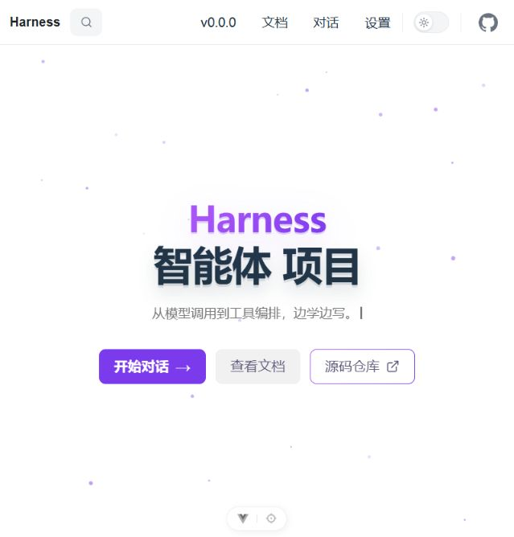
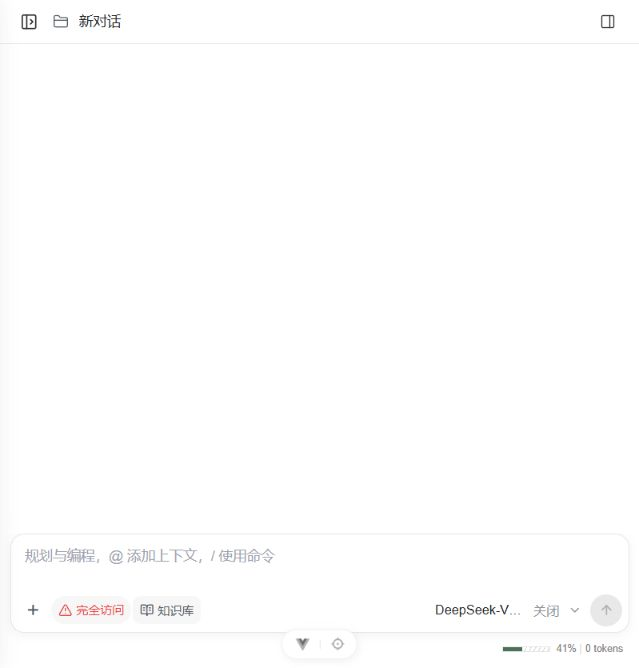
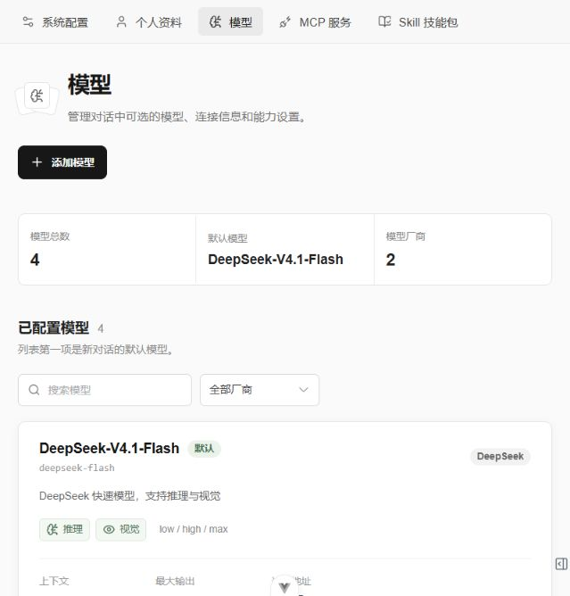
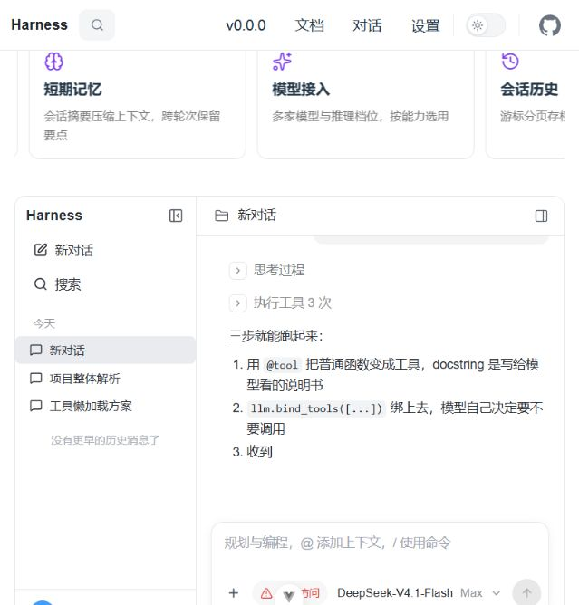
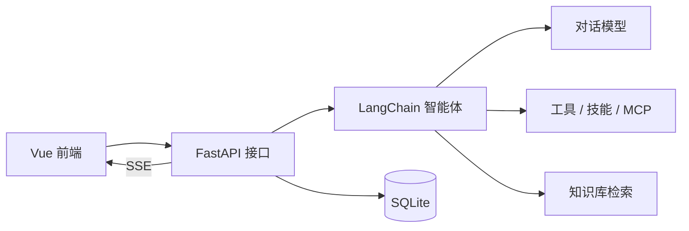

# Harness

一个用于学习和实践 AI 智能体的全栈项目。Harness 将模型对话、工具调用、技能、MCP 服务与知识库放在同一套 Web 界面中，方便查看从用户提问到模型执行的完整过程。



## 目录

- [功能概览](#功能概览)
- [运行截图](#运行截图)
- [技术栈](#技术栈)
- [快速开始](#快速开始)
- [项目结构](#项目结构)
- [配置说明](#配置说明)
- [构建与部署](#构建与部署)

## 功能概览

- **智能体对话**：流式输出回复与工具调用进度，支持停止回复、会话历史、消息检索和文件附件。
- **模型管理**：通过配置文件和设置页面管理对话模型，支持按模型能力选择推理与视觉选项。
- **工具与扩展**：内置文件、文档、图片和网络等工具，并支持技能包、MCP 服务及子代理配置。
- **知识库**：创建知识库、上传文档、索引与检索内容，并在对话中使用检索结果。
- **本地持久化**：使用 SQLite 保存会话、检查点和知识库数据；会话文件保存在独立工作空间。

## 运行截图

以下图片截自本地运行的项目页面。首页的对话预览使用项目内置的演示内容。

### 新对话



### 模型管理



### 首页对话预览



## 技术栈

| 部分 | 主要技术 |
| --- | --- |
| 前端 | Vue 3、TypeScript、Vite、Pinia、Vue Router、Element Plus |
| 后端 | Python 3.12+、FastAPI、Uvicorn、Pydantic |
| 智能体 | LangChain、LangGraph、可配置模型与工具、MCP |
| 数据与检索 | SQLite、sqlite-vec、文档解析与向量检索 |



## 快速开始

### 环境要求

- Python 3.12 或更高版本，以及 [uv](https://docs.astral.sh/uv/)
- Node.js `^22.18.0` 或 `>=24.12.0`，以及 npm
- 至少一个已配置模型对应的 API Key；使用知识库向量检索还需要配置嵌入模型服务地址与密钥

### 1. 获取代码与准备配置

```bash
git clone https://github.com/cjcainiao/harness.git
cd harness
```

在 macOS / Linux 中：

```bash
cp backend/config.example.yaml backend/config.yaml
cp backend/.env.example backend/.env
```

在 Windows PowerShell 中：

```powershell
Copy-Item backend/config.example.yaml backend/config.yaml
Copy-Item backend/.env.example backend/.env
```

编辑 `backend/.env`，填入要使用的模型服务密钥。默认模型配置位于 `backend/config.yaml` 的 `models` 部分；如需更换默认模型或服务地址，也在此文件中调整。请勿提交包含密钥的 `.env` 和 `config.yaml`。

### 2. 启动后端

在一个终端中运行：

```bash
cd backend
uv sync
uv run python -m app.core.main
```

后端默认监听 `http://127.0.0.1:8000`。可通过 [`/health`](http://127.0.0.1:8000/health) 检查服务，并在 [`/docs`](http://127.0.0.1:8000/docs) 查看 FastAPI 接口文档。需要热重载时，可改用 `uv run uvicorn app.core.main:app --reload`。

### 3. 启动前端

在另一个终端中运行：

```bash
cd frontend
npm ci
npm run dev
```

访问 `http://localhost:5173`。开发模式下，Vite 会将 `/api` 请求代理至 `http://127.0.0.1:8000`。如果后端改用其他地址，需要同步调整 `frontend/vite.config.ts` 中的代理目标。

## 项目结构

```text
harness/
├── docs/images/             # README 使用的页面截图
├── backend/
│   ├── app/core/          # FastAPI 入口、路由、业务服务与请求结构
│   ├── harness/           # 智能体、模型、工具、MCP、知识库等框架代码
│   ├── skills/custom/     # 项目自带技能
│   ├── config.example.yaml
│   └── pyproject.toml
├── frontend/
│   ├── src/views/         # 首页、聊天、设置、知识库页面
│   ├── src/api/           # 后端接口调用
│   ├── src/stores/        # Pinia 状态
│   └── package.json
└── build/                 # 部署打包脚本与 Docker Compose 文件
```

后端 HTTP 接口按 `chat`、`config`、`knowledge` 模块组织，默认统一挂在 `/api` 下；`/health` 位于根路径。前端按相同的功能模块组织页面和接口调用。

## 配置说明

| 文件 | 用途 |
| --- | --- |
| `backend/config.example.yaml` | 后端配置模板，包含系统、模型、工具、知识库、技能与 MCP 等选项 |
| `backend/.env.example` | API Key 等环境变量的示例 |
| `frontend/.env.example` | 可选的 `VITE_API_BASE_URL` 示例；默认留空，使用同源 `/api` 路径 |

后端会从 `backend/config.yaml` 读取运行配置，从 `backend/.env` 读取模板中引用的环境变量。默认的数据目录为 `backend/data/`。前端如需跨源直连后端，可在 `frontend/.env` 设置 `VITE_API_BASE_URL`，并在后端配置中允许相应来源。

## 构建与部署

前端可在 `frontend/` 中运行 `npm run build`（包含类型检查），产物位于 `frontend/dist/`。仓库也提供 `build/` 下的打包脚本和 Docker Compose 部署文件，部署目录、端口和挂载说明见 [构建与部署文档](build/README.md)。

**当前部署脚本需先适配代码目录**：`build/build.bat` 和 `build/build.sh` 仍校验旧入口 `backend/app/main.py`，而当前实际入口是 `backend/app/core/main.py`；部署使用的 `build/Dockerfile` 也仍以 `app.main` 启动。因此，现有 `build/` 流程不能直接作为可运行的部署方案使用。
